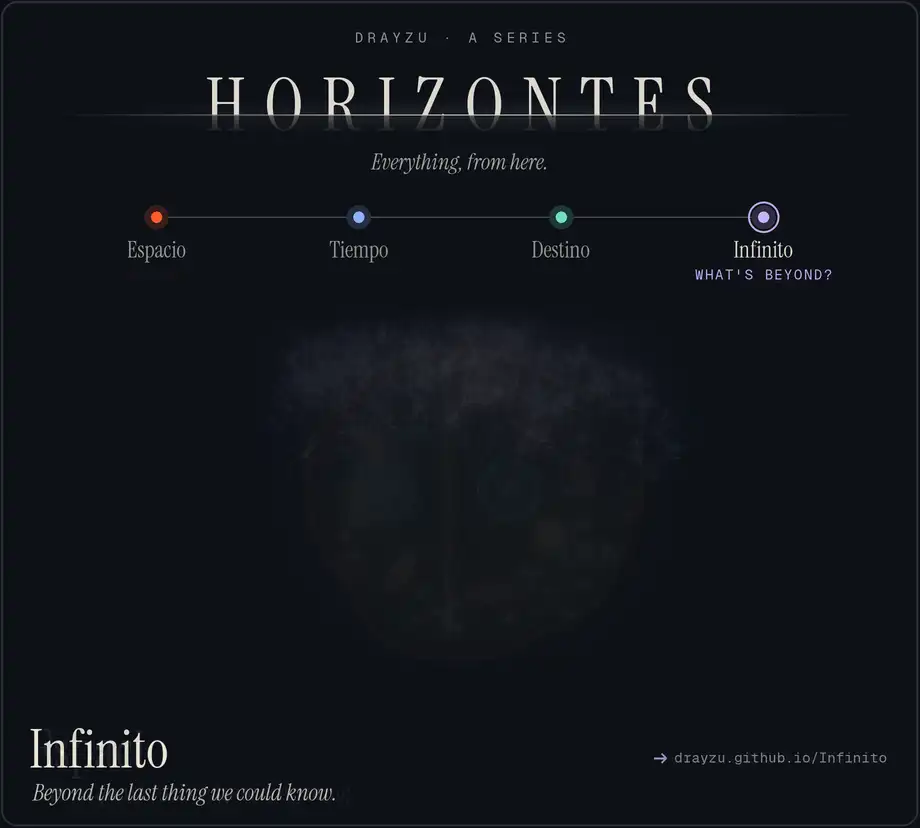
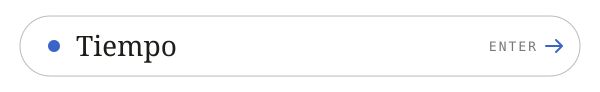
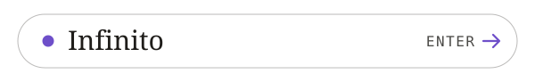

  <picture><source type="image/avif" srcset="media/horizontes.avif"></picture>

  <a href="https://drayzu.github.io/Espacio/"><picture><source media="(prefers-color-scheme: dark)" srcset="media/link-espacio-dark.svg"></picture></a>
  <a href="https://drayzu.github.io/Tiempo/"><picture><source media="(prefers-color-scheme: dark)" srcset="media/link-tiempo-dark.svg"></picture></a>
  <a href="https://drayzu.github.io/Destino/"><picture><source media="(prefers-color-scheme: dark)" srcset="media/link-destino-dark.svg"></picture></a>
  <a href="https://drayzu.github.io/Infinito/"><picture><source media="(prefers-color-scheme: dark)" srcset="media/link-infinito-dark.svg"></picture></a>

  <a href="https://drayzu.github.io/Atlas/"><picture><source media="(prefers-color-scheme: dark)" srcset="media/atlas-dark.svg"></picture></a>

