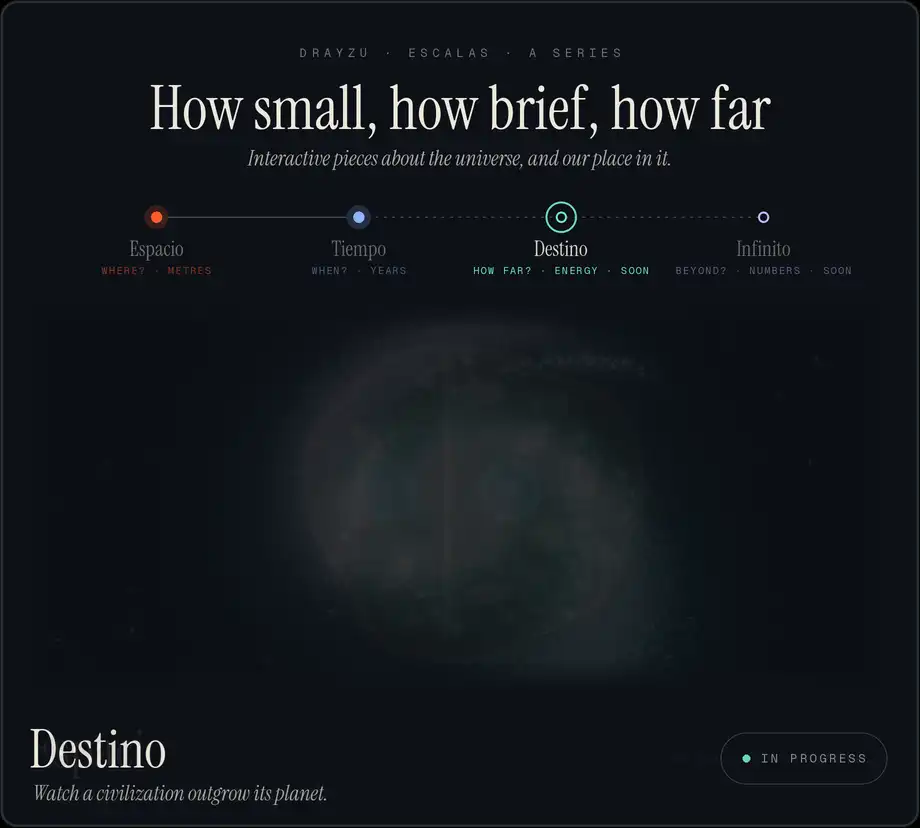

  <picture><source type="image/avif" srcset="media/serie.avif"></picture>

  <a href="https://drayzu.github.io/Potencias/"><picture><source media="(prefers-color-scheme: dark)" srcset="media/link-potencias-dark.svg"></picture></a>
  <a href="https://drayzu.github.io/AstroIngenieria/"><picture><source media="(prefers-color-scheme: dark)" srcset="media/link-astroingenieria-dark.svg"></picture></a>

