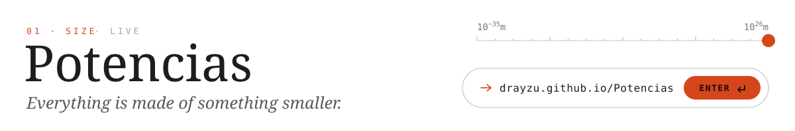
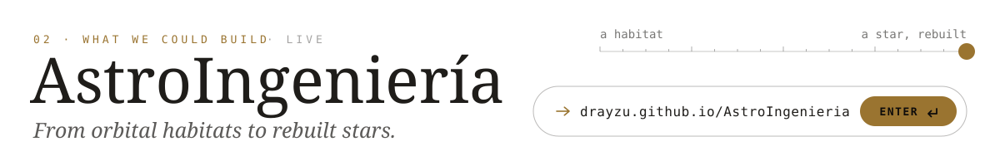

  <picture><source media="(prefers-color-scheme: dark)" srcset="media/header-dark.svg"></picture>

  <a href="https://drayzu.github.io/Potencias/"><picture><source media="(prefers-color-scheme: dark)" srcset="media/potencias-dark.webp"></picture></a>
  <a href="https://drayzu.github.io/Potencias/"><picture><source media="(prefers-color-scheme: dark)" srcset="media/potencias-dark.svg"></picture></a>

 

  <a href="https://drayzu.github.io/AstroIngenieria/"><picture><source media="(prefers-color-scheme: dark)" srcset="media/astroingenieria-dark.webp"></picture></a>
  <a href="https://drayzu.github.io/AstroIngenieria/"><picture><source media="(prefers-color-scheme: dark)" srcset="media/astroingenieria-dark.svg"></picture></a>

  <picture><source media="(prefers-color-scheme: dark)" srcset="media/next-dark.svg"></picture>

  
  

  <picture><source media="(prefers-color-scheme: dark)" srcset="media/series-dark.svg"></picture>

